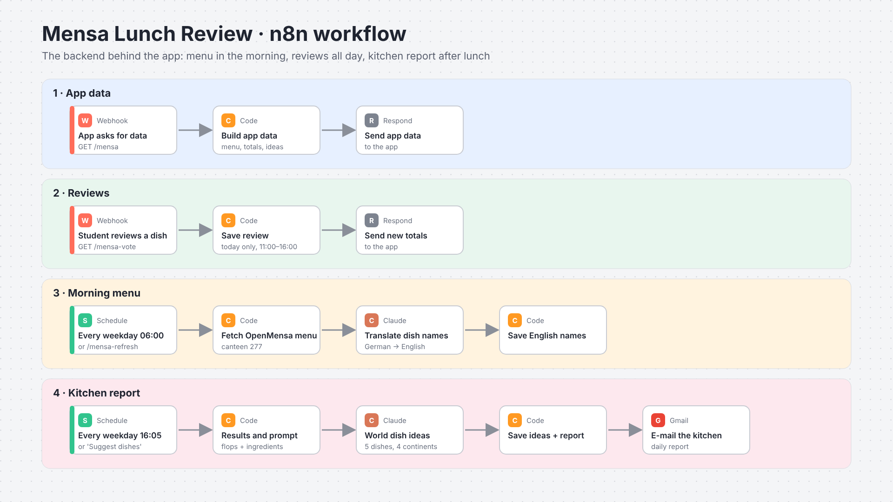

# All for better food: Mensa Lunch Review

## Live demo

- **Full demo (shared votes, AI ideas):** https://claude.ai/artifact/SxLrP63K61zFe9BTrJSNtm. The owner shares it from the Share menu.
- **Standalone demo, straight from this repo:** https://raw.githack.com/RuoyaoYan/allforbetterfood/913fc6cec19bc4c3b5bd0ae6dbdaa10b108251de/index.html. Votes are saved on your own device. This link is pinned to one version (phone frame + n8n), so a cached old copy can't appear. After future changes, update the version ID in the link.

Presenting? See [PRESENTATION.md](PRESENTATION.md). For an offline backup, download the ZIP and open `index.html`; menus, sample results and AI ideas are built in.

After 16:00, press **Open for a demo** on the Rate tab to try voting. At the bottom of the Menu page you can switch between four looks: Market, Pastel, Paper menu and Soft cards.

A front-end-only app for **Mensa am Bildungscampus Heilbronn** (Studierendenwerk Heidelberg).

- **Rate:** students review today's meals ("Loved it" / "Not again") during a review window (default 11:00–16:00, Berlin time). Each dish is a band in the colour of the food, and it fills up as more people love it.
- **Kitchen:** staff see which dishes to stop cooking (at least 50% "not again" from 10+ reviews, adjustable), today's results, and AI suggestions for international dishes that can be made from the ingredients already on the menu, for an international campus.

## n8n backend

The folder [`n8n/`](n8n/) has an importable n8n workflow that acts as the app's backend:
- It fetches and translates the menu every morning.
- It stores everyone's reviews.
- After lunch it asks Claude for world dish ideas and e-mails the kitchen.

Setup steps are in [n8n/README.md](n8n/README.md). Connect the app under **Kitchen → Settings → n8n webhook URL**.

## Pages

- **Menu (front page):** today's dishes as colour bands (tap one to rate it), tomorrow's menu, and yesterday's verdict, i.e. how each dish was rated.
- **Rate:** reviews are open 11:00–16:00. Outside that window, use **Open for a demo** to try voting.
- **Kitchen:** stop-cooking list, AI world-dish ideas, today's results, settings and menu upload.

Demo data: the review numbers (about 100 per dish for today and yesterday) are generated for demos; real reviews are added on top.

## Running it

It's a single static `index.html`, with no build step and no backend.

- **GitHub Pages / any static host (standalone mode):**
  - The menu loads live from the [OpenMensa API](https://openmensa.org/api/v2/canteens/277/meals). `menu.json` is a saved fallback copy.
  - Reviews and settings are saved in the browser (`localStorage`), so each device sees only its own reviews.
  - For AI ideas and menu reading, staff paste an Anthropic API key under Kitchen → Settings. It's kept only in that browser.
- **Claude artifact (hosted mode):** when the page runs inside Claude, it uses Claude's shared storage, so reviews are shared by everyone, and Claude handles the AI suggestions.

## Files

- `index.html`: the whole app
- `menu.json`: saved menu copy used if OpenMensa can't be reached
